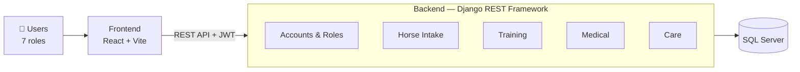

<div align="center">


# EquiTrack — Racehorse Training & Management System

*A full-stack web application for managing a horse racing club: horse intake, training, medical care and daily care.*


</div>

---

## Overview

EquiTrack is a full-stack web application designed to digitize and streamline the daily operations of a horse racing club, covering the whole lifecycle of a racehorse: intake and registration, training, medical care and daily care. The system serves seven user roles—Club Manager, Head Trainer, Trainer, Work Rider, Veterinarian, Groom and Horse Owner—each working in its own workspace within a unified React frontend, backed by a Django REST API and a SQL Server database.

This software solution was engineered as a capstone fulfillment for the SWP391 – Software Development Project curriculum at FPT University Ho Chi Minh City (Fall 2026).

## System Architecture



| Layer | Technology | Responsibility |
|---|---|---|
| **Presentation** | React 19 · Vite 8 · React Router 7 · JavaScript + TypeScript | User interface and a workspace for each of the 7 roles |
| **API** | Django REST Framework · SimpleJWT · drf-spectacular (Swagger) | Receives requests, authenticates users, checks role permissions |
| **Business** | Django 5.2 apps: `accounts`, `horses`, `training`, `medical`, `care`, `core` | Business rules of the four modules: horse intake, training, medical care and daily care |
| **Data** | SQL Server 2019+ (`mssql-django`, ODBC Driver 17/18) | Stores data with constraints and triggers (`sql/horse_v2.sql`) |

## Project Structure

```
Equine_Project/
├── backend/                     # Django REST API
│   ├── apps/
│   │   ├── accounts/            # users, roles, authentication
│   │   ├── horses/              # horse intake: registration, examination, stalls
│   │   ├── training/            # training: assessment, plans, sessions
│   │   ├── medical/             # medical: records, treatments, vaccinations
│   │   ├── care/                # daily care: diet, care tasks, inventory
│   │   └── core/                # shared: permissions, notifications, audit log, tests
│   ├── config/                  # Django settings
│   ├── docs/API.md              # API contract for the frontend
│   ├── manage.py
│   └── requirements.txt
├── frontend/                    # React + Vite web app
│   ├── public/
│   └── src/
│       ├── api/                 # calls to the backend
│       ├── components/          # shared components
│       └── pages/               # landing, manager, owner, vet
├── sql/
│   └── horse_v2.sql             # database script
└── README.md
```

## Getting Started

### Prerequisites

- **SQL Server** 2019+ and **SSMS**
- **Microsoft ODBC Driver** 17 or 18 for SQL Server
- **Python** 3.12+
- **Node.js** 20.19+ or 22.12+ (npm included)

### Default Ports

| Service | Port | URL |
|---|---|---|
| Frontend (Vite) | 5173 | http://localhost:5173 |
| Backend API | 8000 | http://127.0.0.1:8000/api |
| Swagger UI | 8000 | http://127.0.0.1:8000/api/docs |
| Health check | 8000 | http://127.0.0.1:8000/api/health |
| SQL Server | 1433 | `localhost\SQLEXPRESS` |

## Team

| Student ID | Name | GitHub | Role |
|---|---|---|---|
| — | Hằng | [@tabu222](https://github.com/tabu222) | Backend |
| — | Dương | [@bachduong0107](https://github.com/bachduong0107) | Backend |
| — | Minh | [@dangvibaominh-hub](https://github.com/dangvibaominh-hub) | Frontend |
| — | Tiến | [@tien105](https://github.com/tien105) | Frontend |

---

<div align="center">

*SWP391 — FPT University Ho Chi Minh City · For academic purposes only.*

</div>
